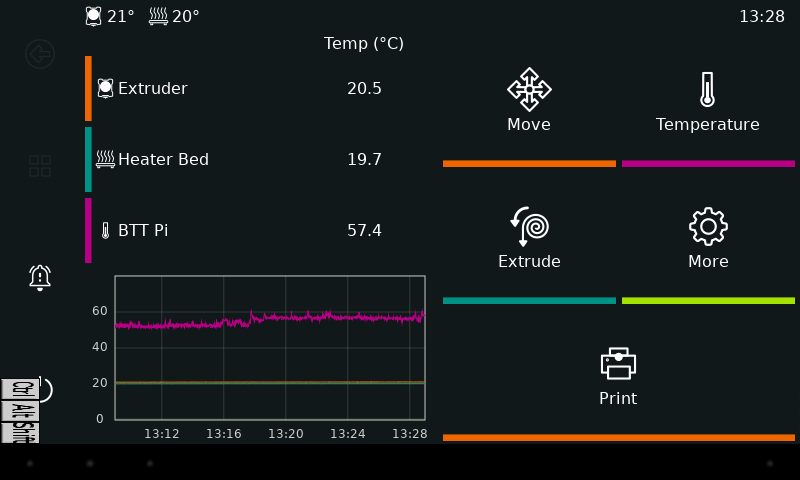

# Klipper Tablet Revival

> **KlipperScreen em um tablet Android 4.2.2, conectado por USB.**

Um tablet Android antigo, recuperado como painel touchscreen do KlipperScreen por **USB**.

Validado em 09/11/2026: BTT Pi/CB1 com Debian 11 ARM64 e tablet **NT-1710, Android 4.2.2, ARMv7**. A interface apareceu no tablet e o usuário confirmou que o toque ficou correto após desativar a emulação de touchpad.



## Arquitetura

```text
Klipper + Moonraker → KlipperScreen no BTT Pi
                              ↓ X11, DISPLAY=:100
                     ADB forward 6100 → 6000
                              ↓ cabo USB
                  XServer XSDL 1.11.40 no Android
                              ↑ toque direto
```

SSH é usado para administração. O transporte da interface entre o BTT Pi e o tablet usa ADB/USB. Não é vídeo HDMI nem espelhamento: o tablet renderiza X11, e o KlipperScreen executa no BTT Pi. O tablet estava também conectado ao Wi-Fi; desligar o Wi-Fi para um teste isolado não foi feito nesta sessão.

## Para reproduzir

1. Siga o [guia principal](docs/COMECE_AQUI.md) para chegar à primeira imagem e testar o toque.
2. Se algo falhar, escolha o sintoma na [FAQ](docs/FAQ.md). Os [reparos avançados](docs/INSTALACAO.md) são apenas para erros específicos e alguns exigem root preexistente.
3. Com a interface funcionando, instale a [reconexão automática](docs/RECONEXAO.md), se desejar.

Referência: [tablet testado](docs/TABLET_TESTADO.md), [toque](docs/TOUCH.md), [diagnóstico e rollback](docs/MANUTENCAO.md), [evidências históricas](docs/HISTORICO.md), [validação](docs/VALIDACAO.md), [procedência](docs/REFERENCIAS.md) e [roteiro para IA](docs/CONTINUAR_COM_IA.md).

## Arquivos executáveis e configuração

| Arquivo | Uso |
|---|---|
| `scripts/launch_KlipperScreen.sh` | Launcher da etapa inicial, baseado no exemplo oficial; preservado como referência |
| `scripts/diagnostico.sh` | Inspeção do sistema, ADB e X11, sem instalação nem comandos de impressora |
| `scripts/patch_touch.py` | Corrige somente clique e movimento relativo no formato Java do XSDL validado; gera outro arquivo |
| `scripts/launch_KlipperScreen-autoconnect.sh` | Launcher atual com espera por Android/X11 e consultas com timeout |
| `scripts/tablet-usb-watchdog.sh` | Supervisor de recuperação do painel, iniciado pelo systemd |
| `scripts/tablet-usb-common.sh` | Funções ADB/X11 compartilhadas, selecionando somente o tablet |
| `config/70-btt-tablet-adb.rules` | Permissão USB exclusiva para o VID/PID observado |
| `checksums.sha256` | Hashes observados dos downloads oficiais |

Não há instalador único: a execução por etapas permite conferir cada resultado. Os scripts **exigem configurar serial, usuário e diretório reais**; valores `<Device...>` são apenas marcadores e fazem os launchers falharem de forma explícita. Não foram incluídos senhas, tokens, APKs, backups do sistema ou configurações da impressora. Obtenha binários das fontes oficiais.

## Resultado e limites

- ADB autorizado, XSDL respondendo via USB, KlipperScreen conectado ao Moonraker.
- Toque direto confirmado pelo usuário; descanso do X11 desativado durante a sessão.
- Nenhum movimento de eixo, extrusão ou aquecimento foi acionado pelo agente.
- Reboots reais do tablet e do BTT testados: interface recuperada automaticamente. [Veja o procedimento e os limites](docs/RECONEXAO.md).
- Supervisor habilitado no boot, com recuperação de ADB/XSDL e reconexão do KlipperScreen.
- Desconexão física do cabo e teste prolongado ainda não validados. Falhas de alimentação ou depuração USB desativada exigem intervenção.

## Créditos

Este resultado só foi possível pelo trabalho dos projetos abaixo:

| Projeto | Contribuição para esta solução |
|---|---|
| [KlipperScreen](https://github.com/KlipperScreen/KlipperScreen) | Interface e exemplo oficial de launcher Android/ADB que adaptamos |
| [SDL Android / XServer XSDL, de pelya e colaboradores](https://github.com/pelya/commandergenius) | Servidor gráfico Android e código usado para entender o toque e os downloads |
| [Klipper](https://github.com/Klipper3d/klipper) | Firmware/ecossistema da impressora controlada |
| [Moonraker](https://github.com/Arksine/moonraker) | API que conecta o KlipperScreen à impressora |
| [Android Platform Tools / ADB](https://developer.android.com/tools/adb) | Comunicação USB e encaminhamento das conexões X11 |

Obrigado aos mantenedores e colaboradores desses projetos. Nossa contribuição aqui é registrar a integração, os ajustes e as evidências deste hardware. Os projetos originais mantêm seus direitos e licenças.

