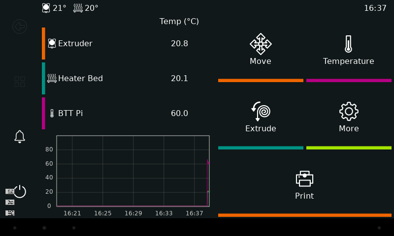
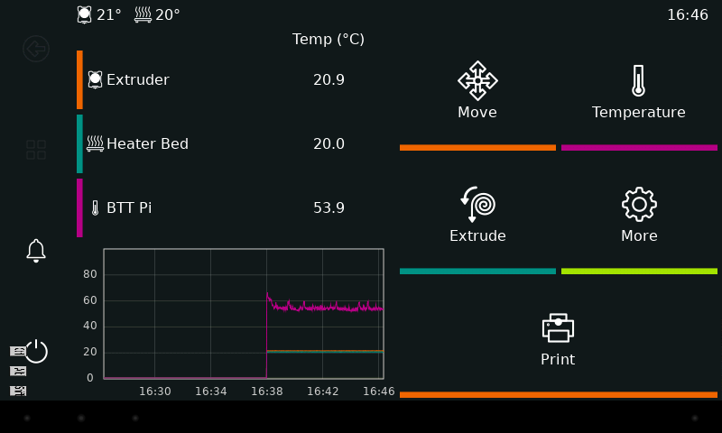

# Backup anterior e recuperação automática do painel

Esta etapa acrescenta supervisão ao painel sem reiniciar Klipper/Moonraker quando o tablet fica indisponível. Backup concluído e validado em 09/11/2026, antes da ativação. O reboot do BTT e o reboot do tablet foram executados e a imagem retornou automaticamente; veja os resultados abaixo.

## Backup antes de alterar a configuração

Destino identificado: pendrive Kingston USB, partição FAT32, UUID `05B1-3EBC`, montado em `/mnt/btt-backup-usb`. Backups anteriores foram preservados. Não houve formatação.

A pasta deste trabalho é `BTT-backup-2026-11-09-before-autoconnect`. O script `scripts/backup_btt_full.sh` é específico do disco/UUID deste BTT e recusa outra origem/destino. Não copie seus identificadores para outro computador sem conferir os discos.

Conteúdo do backup concluído:

- `root.tar.gz.part-*`: todos os arquivos persistentes do sistema raiz, com proprietários numéricos, ACLs, atributos estendidos e arquivos esparsos.
- `boot-partition.img.gz`: imagem da partição de boot inteira.
- `boot-prefix.bin`: primeiros 4 MiB do cartão, incluindo tabela inicial e região de bootloader.
- Tabela de partições em texto e JSON, lista de pacotes, discos e montagens.
- Inventário do arquivo, hashes SHA-256, resultado das verificações e logs.

O sistema tem cerca de 58 GiB, mas usa cerca de 6 GiB. O backup de arquivos compactado cabe no pendrive de 29 GiB. As partes têm 1900 MiB para respeitar FAT32.

Este é um **backup recuperável dos arquivos e estruturas de boot**, não uma imagem bruta única do cartão inteiro. A raiz continua montada durante a cópia. Klipper, Moonraker e KlipperScreen são parados durante a captura para preservar seus dados; serviços básicos do Linux continuam ativos. Alterações de arquivos do sistema durante a cópia são registradas e precisam ser revisadas. Não há promessa de snapshot atômico de todos os serviços ou de restauração já testada em outro cartão.

Não são arquivados sistemas virtuais `/dev`, `/proc`, `/sys`, `/run`, arquivos temporários de `/tmp`, pontos externos em `/mnt` e `/media` ou `lost+found`. O pendrive não é incluído dentro do próprio backup. A partição `/boot` é capturada separadamente.

### Conferir a integridade

Com o pendrive montado, entre na pasta do backup:

```sh
cat RESULT.txt
cat root-pipeline-status.txt
cat root-tar.log
sha256sum -c SHA256SUMS
gzip -t boot-partition.img.gz
cat root.tar.gz.part-* | gzip -t
cat root.tar.gz.part-* | tar -tzf - > /tmp/root-inventory-verificado.txt
```

Os hashes e testes gzip precisam passar. Leia os avisos do tar: arquivos alterados em logs ativos são diferentes de erros de leitura de configuração ou dados. `exit=0` sozinho não substitui a leitura dos registros.

### Como recuperar, em caso de necessidade

A recuperação é feita **em outro Linux, com o BTT desligado e o cartão de destino claramente identificado**. Não execute comandos de gravação contra o BTT em uso.

1. Confira os hashes das partes.
2. Use cartão com capacidade suficiente para o layout registrado em `partition-table.sfdisk`; não basta comparar o nome comercial “64 GB”.
3. Recrie o prefixo de boot/tabela e o layout no cartão correto. Isso apaga o destino: revise o nome do dispositivo antes de gravar.
4. Recrie o ext4 da raiz com o UUID registrado em `disks.txt` e restaure a imagem da partição boot. Preserve os UUIDs esperados pelo sistema ou revise `fstab`/configuração de boot.
5. Monte a raiz de destino e extraia a concatenação das partes como root, usando GNU tar com `--numeric-owner --acls --xattrs`.
6. Recrie os diretórios excluídos: `/dev`, `/proc`, `/sys`, `/run`, `/mnt`, `/media`, `/tmp` (modo 1777). Monte o boot no lugar correto.
7. Sincronize, desmonte e teste a inicialização no BTT. Uma verificação de arquivo não equivale a esse teste de restauração.

O backup contém dados privados do sistema, possivelmente chaves e credenciais. Ele permanece no pendrive; não deve ser enviado ao repositório, mesmo se este estiver privado.

### Resultado da captura

- Início: 09/11/2026, 16:02:08; fim da validação: 16:33:08 (UTC−03).
- Tamanho aproximado: **2,9 GiB**, com duas partes do sistema raiz.
- Pipeline tar/gzip/split: `0 0 0`; resultado final `exit=0`.
- Inventário lido: **120.222 entradas**.
- Testes gzip e leitura integral do tar concluídos sem erro.
- SHA-256: `boot-prefix.bin`, `boot-partition.img.gz`, `root.tar.gz.part-000` e `root.tar.gz.part-001`: **todos OK**.
- Únicos avisos: sockets temporários `klippy.sock` e `moonraker.sock` ignorados; os serviços os recriam.
- Serviços da impressora religados após a captura. Pendrive sincronizado e desmontado antes do reboot do BTT.

## Componentes da reconexão

| Arquivo instalado | Função |
|---|---|
| `/usr/local/lib/tablet-usb-common.sh` | Consultas ADB com timeout, seleção exclusiva do tablet, encaminhamento USB e teste X11 |
| `<DeviceHome>/KlipperScreen/scripts/launch_KlipperScreen.sh` | Aguarda ADB/Android/XSDL e executa o cliente configurado pelo serviço original |
| `/usr/local/bin/tablet-usb-watchdog.sh` | Verifica presença USB, fim do boot Android e resposta X11; recupera apenas o painel |
| `/etc/systemd/system/tablet-usb-watchdog.service` | Inicia o supervisor junto com o Linux e o reinicia se o supervisor falhar |

O launcher novo está no repositório como `scripts/launch_KlipperScreen-autoconnect.sh`; o launcher inicial permanece documentado como referência.

O supervisor roda como root para reiniciar **somente KlipperScreen**, mas executa ADB/X11 com o usuário `<DeviceUser>` por `setpriv`. Não abre ADB pela rede, não altera regras da webcam e não envia G-code.

### Recuperação

1. Tablet ausente: aguarda; não reinicia o BTT nem o firmware da impressora.
2. Android iniciando: espera `sys.boot_completed=1`.
3. Android disponível: restabelece `tcp:6100 → tcp:6000`, abre XSDL se necessário e verifica `xset`.
4. X11 recuperado ou boot Android mudou: reinicia KlipperScreen para reconectar seu cliente ao servidor.
5. XSDL falha sucessivamente: reabre somente o aplicativo, com intervalo mínimo de 180 segundos entre tentativas de reset.

As consultas têm timeout. O intervalo normal de verificação é 10 segundos; chamadas e inicialização do aplicativo somam tempo. Não é uma garantia de recuperação em exatamente 10 segundos.

Uma consulta X11 usa até 12 segundos. Uma falha isolada com o painel já conectado precisa de confirmação antes de disparar recuperação. Após reiniciar KlipperScreen, o supervisor dá 20 segundos para o primeiro desenho, mais pesado neste Android. Esse ajuste foi motivado por uma consulta lenta observada no teste inicial.

O procedimento pode acender a tela quando `dumpsys power` confirma que ela está apagada e enviar MENU para dispensar uma tela simples. Não remove PIN/senha. Falta de alimentação, cabo defeituoso, depuração desativada ou autorização ADB revogada continuam exigindo intervenção.

O modo dedicado (`TABLET_KEEP_FOREGROUND=1`) verifica a janela Android em foco e traz o XSDL para frente se outro aplicativo ocupar a tela. Isso foi acrescentado após encontrar a tela de um app VNC preexistente durante os testes. Ele não remove nem reconfigura o VNC. Para usar o Android normalmente, pare o supervisor temporariamente; alternativamente, ajuste a variável para 0 no arquivo comum. Sem essa opção, a conexão X11 pode funcionar enquanto outro app cobre a interface.

Neste Android, colocar SDL em segundo plano também pode pausar as respostas X11. Por isso a verificação de primeiro plano vem **antes** do teste X11: o supervisor retoma o app e só depois decide se há uma falha gráfica. Evita reiniciar o cliente apenas porque a tela inicial cobriu o XSDL.

## Testes reais de recuperação

| Cenário | Evidência |
|---|---|
| Tablet reiniciado por ADB | `boot_id` Android mudou, ADB reapareceu, `sys.boot_completed=1`, XSDL abriu e KlipperScreen voltou sem ação na tela |
| BTT reiniciado por `reboot` | `boot_id` Linux mudou; supervisor subiu automaticamente e a impressora foi inicializada pelo KlipperScreen |
| XSDL encerrado com `am force-stop` | Aplicativo reaberto e cliente reconectado automaticamente |
| Aplicativo fora de foco | Supervisor retoma XSDL como painel dedicado; teste com tecla HOME do Android |

No reboot do BTT iniciado às 16:37:03, o supervisor registrou reconexão X11 às 16:37:23 e o KlipperScreen registrou a impressora inicializada às 16:37:43. No segundo reboot do tablet iniciado às 16:37:58, o Android terminou o boot e o supervisor registrou a reconexão às 16:39:24. São tempos observados, não um prazo máximo garantido.





Os scripts foram refinados durante os testes para tolerar o primeiro desenho lento e assegurar primeiro plano. O BTT foi reiniciado após ativar a unidade; refinamentos posteriores mantêm a mesma unidade habilitada e o mesmo launcher, alterando apenas a supervisão.

Não foi executado um teste de restauração do backup em outro cartão, nem uma retirada física do cabo. O fato de esses cenários não terem sido testados não é escondido pela recuperação bem-sucedida dos reboots.

### Verificar e desativar

```sh
systemctl status tablet-usb-watchdog --no-pager
journalctl -u tablet-usb-watchdog -n 40 --no-pager
adb devices -l
timeout 8 xset -display :100 -q
```

Para reverter, desative o supervisor com `sudo systemctl disable --now tablet-usb-watchdog`, restaure o launcher salvo antes da alteração e reinicie somente KlipperScreen. Não é preciso restaurar todo o cartão para desfazer a automação.

## Instalação explícita dos componentes

Execute no BTT, a partir da raiz deste repositório, **depois de verificar o backup**. Os nomes de usuário, serial e caminhos são deste equipamento. Adapte `tablet-usb-common.sh` para outro ambiente. O serviço anterior do KlipperScreen precisa estar habilitado e definir `KS_XCLIENT`.

```sh
mkdir -p ~/tablet-xsdl/autoconnect-before-20261109
cp ~/KlipperScreen/scripts/launch_KlipperScreen.sh ~/tablet-xsdl/autoconnect-before-20261109/launch_KlipperScreen.sh
sudo systemctl cat KlipperScreen > ~/tablet-xsdl/autoconnect-before-20261109/KlipperScreen.service.txt
bash -n scripts/tablet-usb-common.sh
bash -n scripts/tablet-usb-watchdog.sh
bash -n scripts/launch_KlipperScreen-autoconnect.sh
sudo install -m 0644 scripts/tablet-usb-common.sh /usr/local/lib/tablet-usb-common.sh
sudo install -m 0755 scripts/tablet-usb-watchdog.sh /usr/local/bin/tablet-usb-watchdog.sh
install -m 0755 scripts/launch_KlipperScreen-autoconnect.sh ~/KlipperScreen/scripts/launch_KlipperScreen.sh
sudo install -m 0644 config/tablet-usb-watchdog.service /etc/systemd/system/tablet-usb-watchdog.service
sudo systemctl daemon-reload
sudo systemctl enable --now tablet-usb-watchdog
sudo systemctl restart KlipperScreen
```

Não substitua arquivos existentes sem preservar suas cópias; o diretório de backup acima deve ser novo em outra execução. As cópias usadas nesta sessão foram preparadas em `/tmp` para não alterar a configuração antes do backup.

### Como testar a recuperação

Confirme antes que não há impressão em andamento. Faça um cenário por vez, aguardando a interface voltar e verificando o log do supervisor:

1. Reinicie somente o tablet por ADB, sem intervenção na tela, e aguarde.
2. Confirme novo `boot_id` Android, `device`, resposta X11, processo KlipperScreen e captura da tela.
3. Reinicie somente o BTT; o SSH vai cair e precisará reconectar. Confirme novo `boot_id` Linux e recuperação dos serviços.
4. Encerre apenas o XSDL e confira se o supervisor o reabre e reconecta o cliente.

Esses testes comprovam os cenários executados, não falhas físicas de cabo/alimentação nem situações com autorização ADB revogada. Um teste de desconexão real do cabo requer acesso físico.
