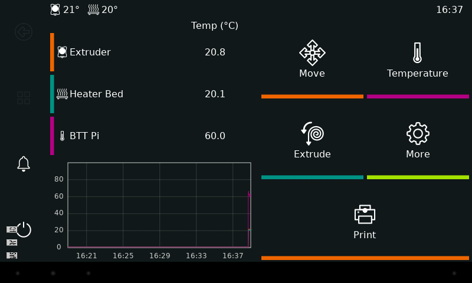
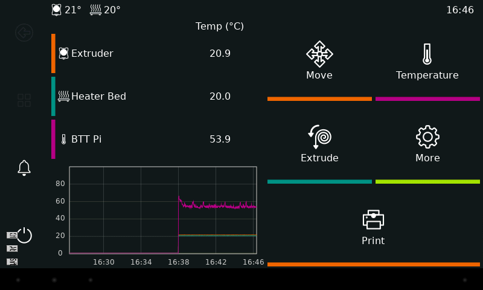

# Automatic panel reconnection

This optional step restores the tablet panel after an Android or BTT reboot. The supervisor recovers **only the panel and KlipperScreen**, not Klipper, Moonraker or the BTT itself. Complete the [main guide](COMECE_AQUI.md) and confirm ADB/X11 before installing it.

## How it works

| Installed file | Role |
|---|---|
| `/usr/local/lib/tablet-usb-common.sh` | Timed ADB/X11 checks restricted to the selected tablet |
| `~/KlipperScreen/scripts/launch_KlipperScreen.sh` | Waits for Android/XSDL and runs the client configured by the original unit |
| `/usr/local/bin/tablet-usb-watchdog.sh` | Monitors USB, Android boot and X11; recovers the panel |
| `/etc/systemd/system/tablet-usb-watchdog.service` | Starts and restarts the supervisor with Linux |

The repository's replacement launcher is `scripts/launch_KlipperScreen-autoconnect.sh`; the simpler initial launcher remains for the first setup. The supervisor runs as root to restart **only KlipperScreen**, but executes ADB/X11 as the configured BTT user through `setpriv`. It does not open network ADB, alter other USB device rules, or send G-code.

When the tablet is absent or booting, the supervisor waits. Once ADB reports `sys.boot_completed=1`, it restores `tcp:6100 → tcp:6000`, brings XSDL to the foreground if needed, checks `xset`, and restarts KlipperScreen after X11 responds or the Android boot ID changes. Repeated XSDL failures reopen only the app, with at least 180 seconds between force-stop attempts. Checks have timeouts; a slow X11 query is confirmed before recovery and a restart allows 20 seconds for the first draw. The ten-second normal loop is **not** a guaranteed recovery deadline.

With `TABLET_KEEP_FOREGROUND=1`, the tablet is a dedicated panel: if another Android app covers XSDL, the supervisor brings XSDL forward. This was added after a pre-existing VNC app appeared during testing; it was not removed or reconfigured. To use Android normally, stop the supervisor temporarily or set this value to `0` in the installed common script. On this Android, backgrounding SDL could also pause X11 responses, so foreground restoration occurs before declaring X11 failed.

The supervisor may wake a sleeping screen and send MENU to dismiss a simple lockscreen. It cannot remove a PIN/password. Power loss, a bad cable, disabled USB debugging and revoked ADB authorization still require intervention.

## Install on the BTT

Run from the repository root. The existing KlipperScreen unit must be enabled and provide `KS_XCLIENT`. Note your `adb devices -l` serial, `id -un` username and `printf '%s\n' "$HOME"` path. Create a **new backup directory on every run**, preserving any existing launcher, common script, supervisor and unit:

```sh
mkdir -p ~/tablet-xsdl
backup_dir=$(mktemp -d "$HOME/tablet-xsdl/autoconnect.XXXXXXXX")
for file in "$HOME/KlipperScreen/scripts/launch_KlipperScreen.sh" /usr/local/lib/tablet-usb-common.sh /usr/local/bin/tablet-usb-watchdog.sh /etc/systemd/system/tablet-usb-watchdog.service; do
    if sudo test -e "$file"; then
        sudo cp "$file" "$backup_dir/"
    fi
done
systemctl cat KlipperScreen > "$backup_dir/KlipperScreen.service.txt"
echo "Backup: $backup_dir"
bash -n scripts/tablet-usb-common.sh
bash -n scripts/tablet-usb-watchdog.sh
bash -n scripts/launch_KlipperScreen-autoconnect.sh
sudo install -m 0644 scripts/tablet-usb-common.sh /usr/local/lib/tablet-usb-common.sh
sudoedit /usr/local/lib/tablet-usb-common.sh
sudo bash -c 'source /usr/local/lib/tablet-usb-common.sh; tablet_online'
```

In `sudoedit`, replace the three redacted values `<DeviceSerialNumber>`, `<DeviceUser>` and `<DeviceHome>` **only in the assignment lines**, keeping the quotes. Leave the validation condition below them unchanged. Do not continue if `tablet_online` fails. Keep the displayed backup path for rollback.

After validation:

```sh
sudo install -m 0755 scripts/tablet-usb-watchdog.sh /usr/local/bin/tablet-usb-watchdog.sh
install -m 0755 scripts/launch_KlipperScreen-autoconnect.sh ~/KlipperScreen/scripts/launch_KlipperScreen.sh
sudo install -m 0644 config/tablet-usb-watchdog.service /etc/systemd/system/tablet-usb-watchdog.service
sudo systemctl daemon-reload
sudo systemctl enable --now tablet-usb-watchdog
```

The supervisor restarts KlipperScreen only when X11 is ready. Verify:

```sh
systemctl status tablet-usb-watchdog --no-pager
journalctl -u tablet-usb-watchdog -n 40 --no-pager
adb devices -l
timeout 8 xset -display :100 -q
```

To disable it, run `sudo systemctl disable --now tablet-usb-watchdog`, restore the saved launcher, then restart only KlipperScreen. See [rollback](MANUTENCAO.md).

## Observed recovery tests

| Scenario | Result |
|---|---|
| Tablet rebooted via ADB | Android `boot_id` changed; ADB returned, boot completed, XSDL opened and KlipperScreen returned without screen interaction |
| BTT rebooted | Linux `boot_id` changed; supervisor started at boot and KlipperScreen initialized the printer |
| XSDL force-stopped | The app reopened and its X11 client reconnected |
| Another app in foreground | The supervisor restored XSDL as a dedicated panel after Android HOME |

In one BTT reboot, started at 16:37:03, the supervisor logged X11 recovery at 16:37:23 and KlipperScreen logged printer initialization at 16:37:43. After a tablet reboot started at 16:37:58, the supervisor logged reconnection at 16:39:24. These are observations, **not** upper bounds. Later script refinements retained the same enabled unit and launcher, changing only supervision.





Before reproducing a reboot test, make sure no print is in progress. Test one scenario at a time, wait for the interface, and inspect the supervisor log and relevant boot ID. Physical cable removal/reconnection has **not** been tested; those results do not prove recovery from a bad cable, power loss or revoked authorization.
